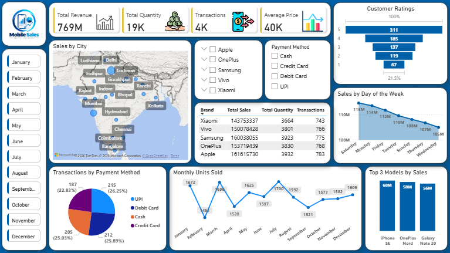
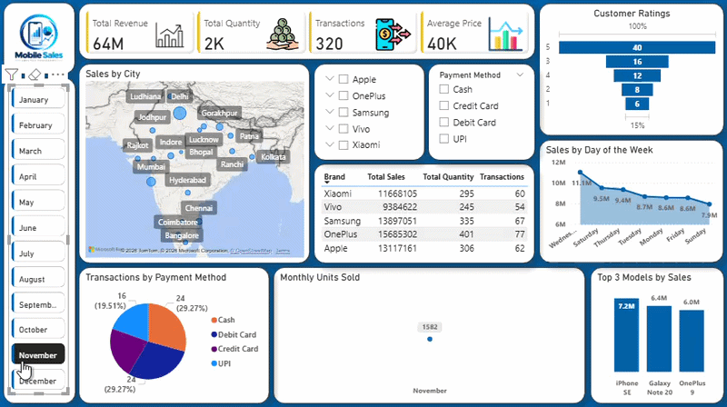

# Mobile Sales Analysis Dashboard | Power BI

## Project Overview

An interactive Power BI dashboard designed to analyze mobile phone sales performance, revenue, transactions, customer ratings, and purchasing trends. The dashboard provides insights into sales patterns across cities, brands, mobile models, and payment methods.

## Tools & Technologies

- Microsoft Power BI
- Power Query
- DAX
- Microsoft Excel
- Data Visualization

## Dashboard Preview

## Interactive Dashboard Demo

## Key Performance Indicators (KPIs)

- **Total Revenue:** 769M
- **Total Quantity Sold:** 19K
- **Total Transactions:** 4K
- **Average Price:** 40K

## Dashboard Features

- **Sales by City:** Explore the geographical distribution of mobile sales.
- **Monthly Filter:** Analyze sales data for individual months.
- **Brand Performance:** Compare Apple, OnePlus, Samsung, Vivo, and Xiaomi.
- **Payment Method Analysis:** Examine transactions made through UPI, debit cards, credit cards, and cash.
- **Customer Ratings:** Understand customer rating distributions.
- **Weekly Sales Trends:** Compare sales performance across days of the week.
- **Monthly Units Sold:** Track monthly changes in sales quantity.
- **Top 3 Mobile Models:** Identify leading mobile models based on sales performance.

## Business Analysis

The dashboard helps explore:

- Revenue and sales performance across mobile brands.
- Monthly and weekly sales patterns.
- Customer payment preferences.
- City-wise sales distribution.
- Customer ratings and popular mobile models.

## Project Files

- `Mobile_Sales_Analysis.pbix` — Interactive Power BI dashboard.
- `Mobile_Sales_Data.xlsx` — Excel dataset used for analysis.
- `Mobile_Sales_Dashboard.png` — Static dashboard preview.
- `Mobile_Sales_Demo.gif` — Animated dashboard demonstration.

## Conclusion

This project demonstrates practical skills in Power BI dashboard development, data visualization, KPI reporting, and business analysis. It transforms mobile sales data into an interactive dashboard that helps users explore sales performance and customer purchasing patterns.